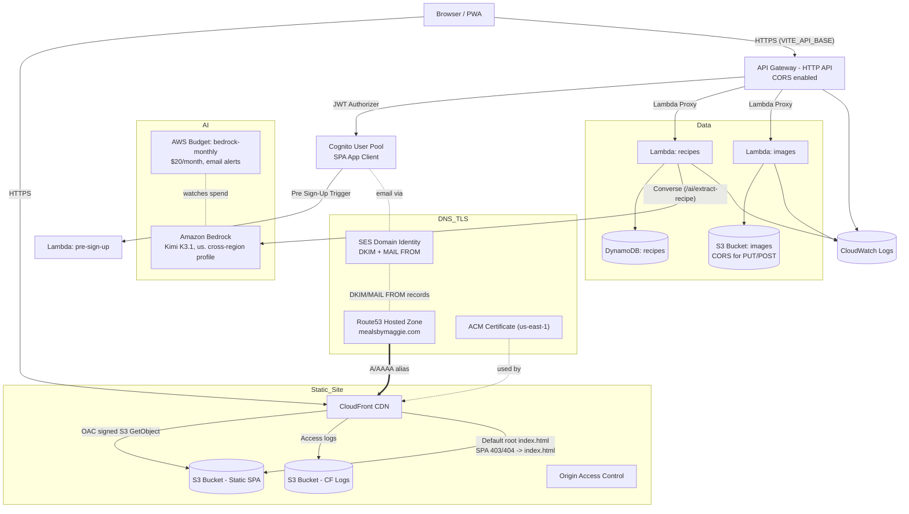

# Architecture

This document summarizes the app and infrastructure topology for the Meals by Maggie (mbm-ui) project.

## Diagram

## Legend and notes
- Static site: SPA assets are served from S3 through CloudFront using an Origin Access Control (OAC). CloudFront maps SPA 403/404 to `index.html` for client-side routing.
- DNS/TLS: Route53 provides apex and `www` aliases to CloudFront. ACM cert (in us-east-1) is attached to CloudFront. SES verifies the sending domain with DKIM and an optional custom MAIL FROM.
- Auth: The SPA uses Cognito (Amplify SRP). A pre-sign-up Lambda validates invite codes in DynamoDB.
- API: API Gateway (HTTP API) fronts Lambdas. Public routes: `GET /recipes`, `GET /recipes/{id}`, `GET /images/{key+}`. Auth-required routes (JWT): `POST /recipes`, `PUT /recipes/{id}`, `DELETE /recipes/{id}`, `POST /ai/extract-recipe`, `POST /images`. Recipe bodies are validated against the editable fields in `lambda/recipes/recipe_input.py`; anyone signed in can edit, only the creator or an admin can delete. (The old `/ratings` routes were removed; the `mbm-ratings` table is kept but unused.)
- AI recipe import: `POST /ai/extract-recipe` (card scan, link or pasted text) is handled by the recipes Lambda (`ai_extract.py`). For links it uses the page's schema.org Recipe JSON-LD when present; otherwise it calls Bedrock Converse with a forced `save_recipe` tool call. The model is Kimi K3.1 through the `us.moonshotai.kimi-k3.1` inference profile (us-east-1, us-east-2, us-west-2), with no `temperature` and `reasoning_effort: "low"` to stay well under the 30 s Lambda/API Gateway timeout. It runs in the app account (217354297026) with the Lambda's own IAM role; the role also allows Sonnet 4.6 and Haiku 4.5 for rollback (AWS caps Anthropic models in this org at 10 requests/min). The `bedrock-monthly` budget ($20/month) alerts at $5 actual, 80% actual and 100% forecast. The old cross-account setup in rjl-ai-dev (`terraform/ai_account`) is unused and will be removed.
- Images: The images Lambda returns presigned PUT/POST data for uploads and redirects `GET /images/{key}` to a presigned GET URL.
- Observability: Lambdas and API write to CloudWatch Logs. CloudFront logs to a dedicated S3 bucket with lifecycle management.

## File map (where things live)

Terraform (infrastructure)
All under `terraform/app_account/`:
- CloudFront + site bucket + logs: `main.tf`
- TLS + aliases + redirect function: `acm.tf`
- Hosted zone + SES (DKIM/Mail From): `route53.tf`
- Backend API (DynamoDB, S3 images, IAM incl. Bedrock, Lambdas, API Gateway, Cognito): `backend_api.tf`
- Link previews (Lambda@Edge for `/recipe/*`): `link_previews.tf`
- Bedrock budget: `budgets.tf`
- S3 static site module: `modules/s3-static-site/main.tf`
- Lambda handlers: `lambda/recipes/app.py` (routes; `router.py`, `repo.py`, `authz.py`, `recipe_input.py`, AI import in `ai_extract.py`), `lambda/images/app.py`, `lambda/auth/`, `lambda/preview/app.py`
- Lambda tests (pytest + moto): `lambda/tests/`

Frontend (application)
- App entry and features: `src/App.tsx`
- Storage adapters (local/remote): `src/lib/storage.ts`
- Amplify/Cognito config: `src/auth/amplify.ts`
- Cognito auth hook: `src/hooks/useCognitoAuth.ts`

## Related docs
- Quickstart & deploy: `README.md`
- Terraform usage and backend state: `terraform/app_account/README.md`
- UI features overview: `FEATURES-README.md`
